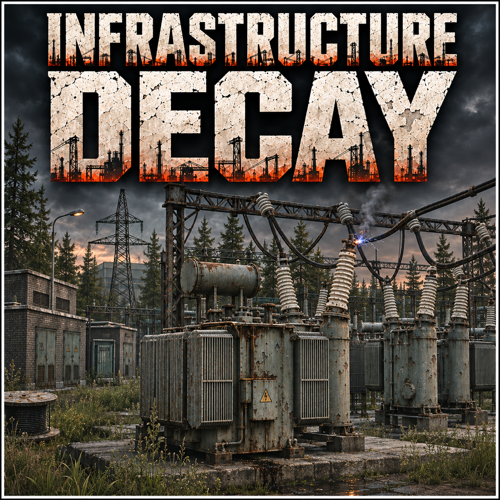

# Infrastructure Decay

**Tarkov’s power grid is failing.** Lights stutter, buildings go dark, and powered controls stop responding until electricity returns.

Created by **killdg**, with assistance from **ChatGPT**. For **SPT 4.1.6 / EFT 0.16.9.5.40743**. Version **1.0.6 — experimental**.

## What it does

- Random power interruptions during daytime and nighttime raids, including Labs and Factory.
- **Eight abrupt flicker patterns** leading into a blackout, plus **six recovered-surge patterns** where the grid recovers.
- Dims supported point/spot lights, native managed and area lights, fixture glow, and recognized screen/sign emission.
- Temporarily blocks native light switches, powered exit controls and other electrical buttons. Access returns when power does.
- Leaves ordinary manual doors, player flashlights and already-activated extractions alone.
- Restores owned light changes when power returns, the mod is disabled, or the raid ends.

## Install and configure

1. Close Tarkov.
2. Download **Infrastructure-Decay-1.0.6.zip** from [Releases](https://github.com/killdg/Infrastructure-Decay/releases).
3. Copy the ZIP’s **BepInEx** folder into your **SPT game folder**, merging folders.
4. Start SPT and Tarkov. The mod is enabled automatically.
5. Press **F1**, then expand **Infrastructure Decay**, to adjust settings in the Configuration Manager used by the test setup.

The installed file is `BepInEx/plugins/InfrastructureDecay/InfrastructureDecay.Client.dll`.
There is **no server mod**; it will not appear in SPT.Server’s server-mod list.

If your setup has no F1 Configuration Manager, settings can also be edited while the game is closed in `BepInEx/config/com.killdg.infrastructuredecay.cfg`. The menu provider is not included in this download; the effect itself requires no additional gameplay mod.

### Default settings

| Setting | Default |
|---|---|
| Enabled | On |
| First scheduled roll | 3–5 minutes into the raid |
| Later rolls | Every 3–6 minutes after recovery or a failed roll |
| Night event chance, 20:00–06:00 | **60% per roll** |
| Day event chance | **20% per roll** |
| Blackout duration | **30–120 seconds** |
| Recovered surge chance | **35% of successful rolls after the first successful outage** |
| Remaining controllable light output during blackout | **0%** |
| Block light switches | On |
| Block powered exit controls | On |
| Block other electrical buttons | On |

The opening window also makes a chance roll: it is **not guaranteed**. The first successful event is a blackout; later successful rolls may recover after a brief flicker. Timings, chances, brightness and control blocking are adjustable. Saved settings survive updates.

Outage flickers last about **0.65–1.3 seconds** before darkness. Recovered surges last about **0.8–1.5 seconds**, without disabling powered controls.

## Compatibility and limits

- Developed and tested in an **SPT test installation without Fika or third-party gameplay mods**. RR, Return Of Thunderstorms and optional developer tools were present in some tests; this does not establish isolated or universal compatibility.
- **Fika synchronization is not implemented or verified.** Different clients can independently roll outages; this is a solo-SPT release.
- RR is **not required**. When RR’s Infrastructure Decay or Lab Work Day owns lighting, this standalone plugin yields to it using a read-only in-process metadata lookup.
- Baked lighting and unsupported projection/video/unlit surfaces may remain bright. This mod does **not** guarantee total darkness.
- Buttons using native `Switch` objects and explicit linked-switch chains are covered. Other control mechanisms need separate verification. Already-active extracts are not cancelled.
- Some effects may conflict with other lighting/interaction mods. Player equipment and ordinary surface textures are excluded from automatic dimming.

## Testing status

**67 automated scheduling, flicker-pattern and native-contract checks pass.** The release build has no compilation warnings or errors. See [testing details](docs/TESTING.md).

Live Labs tests established partial light suppression and powered-button refusal. An earlier version exposed a button lockout; the implementation now refuses interaction before native locking. Complete latest-version button recovery, visual coverage and the new day/night balance still require live verification. This release is marked experimental accordingly.

## Transparency and source

All original source is public, readable C#, without minification or obfuscation. [Engine integration](docs/ENGINE-INTEGRATION.md) explains native hooks, shader fields, cleanup and performance limits. [Data scope](docs/DATA-SCOPE.md) documents file and optional-mod integration.

The plugin makes **no network requests**, collects no telemetry, downloads no code/assets, and creates no services, scheduled jobs or background workers. It does not edit profiles or system files. BepInEx handles normal local settings and logging.

Release binaries are built from the exact tagged source. Release assets include source, SHA-256 checksums and build provenance. Game/SPT/BepInEx binaries are referenced locally for compilation and **are not redistributed**.

[Build instructions](docs/BUILDING.md) · [MIT license](LICENSE)

## Optional developer tools

Normal players do not need DG Testing Tools, and it is not bundled. If installed separately, manual outage/surge actions and isolated light-source tests appear under **F1 → DG Testing Tools**. Their provider stays inside this plugin; no external executable or network process is invoked.
